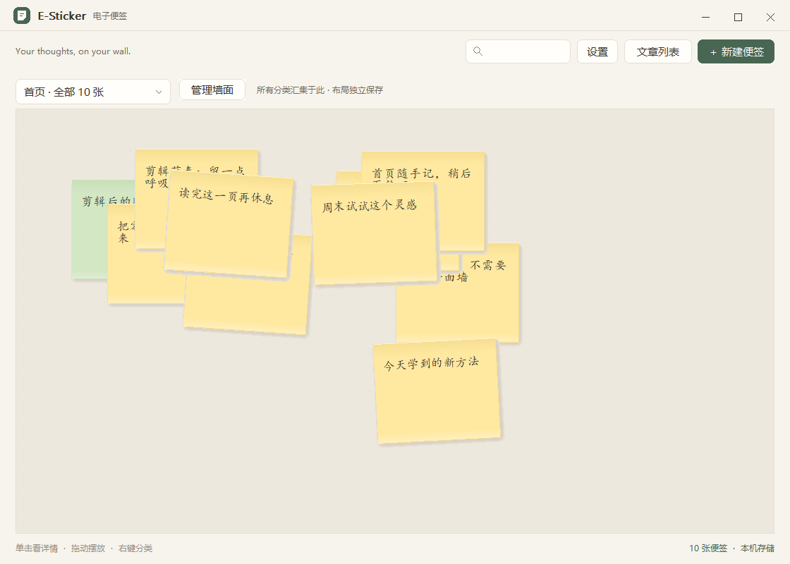
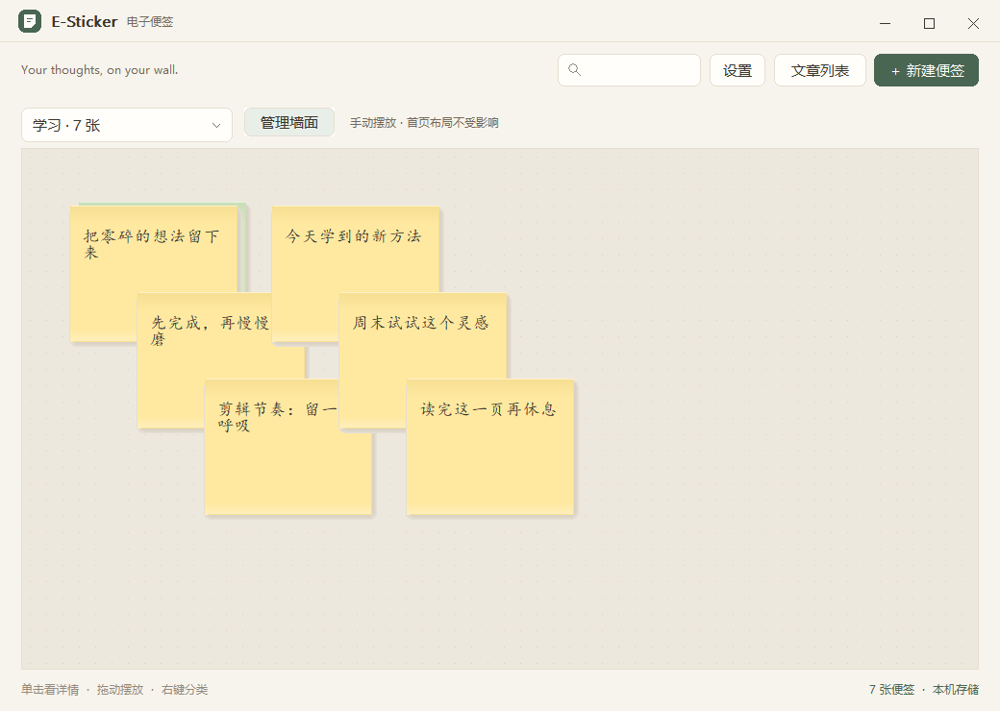
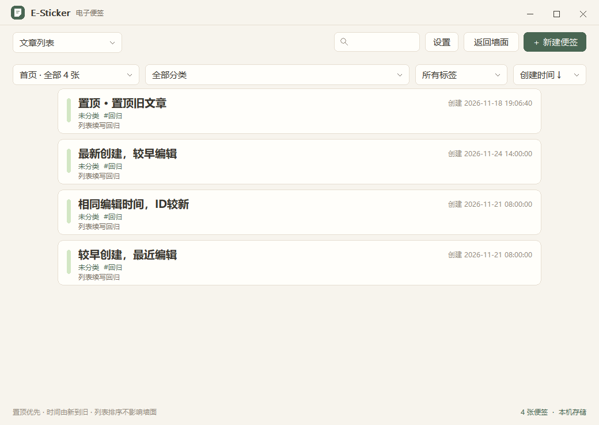
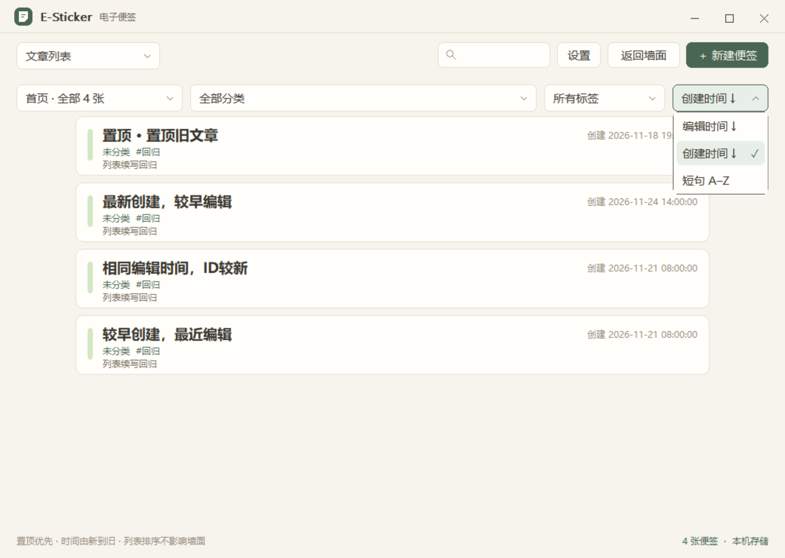
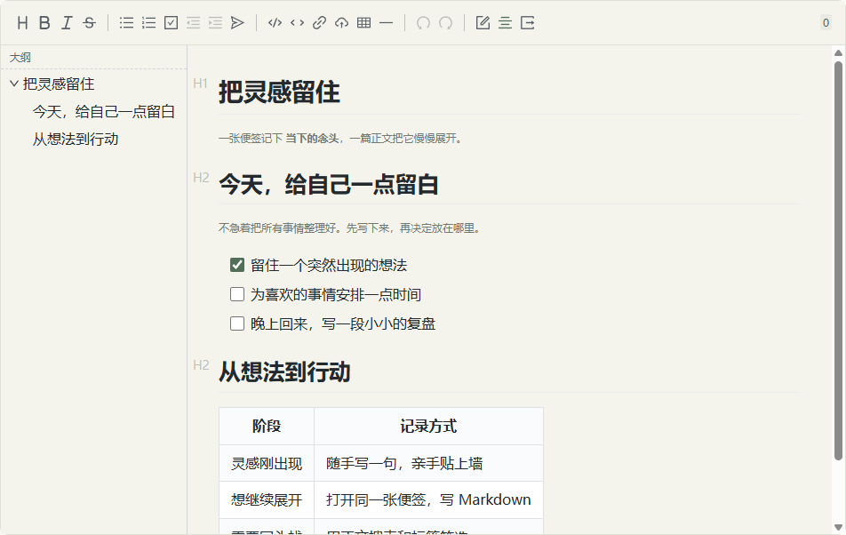
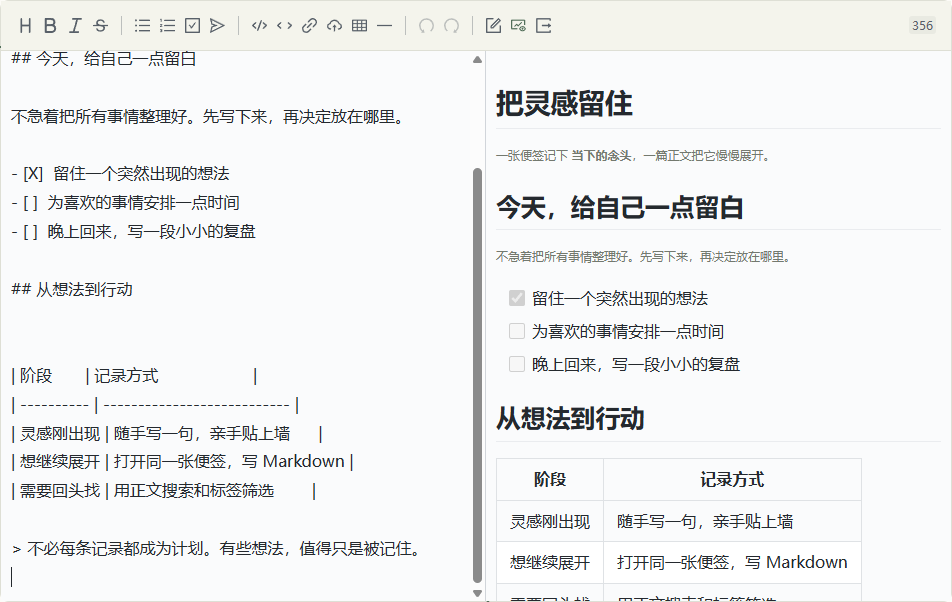
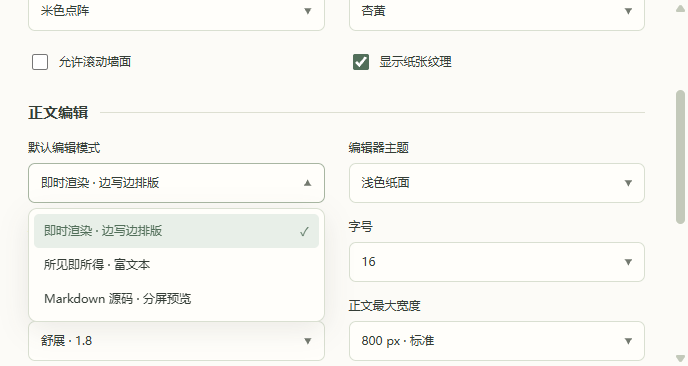

# E-Sticker

**像纸一样贴，像文章一样找。** E-Sticker 是一款轻量的 Windows 本地电子便签。先在纸上写一句，亲手贴到墙上；想记更多时，再打开同一张便签补写 Markdown。

**Windows x64 · 本地存储 · 原生便签墙 · 离线 Markdown 编辑器**



## 可以做什么

- **随手记，亲手贴**：五种纸色，自由摆放和重叠，不自动重排你的墙面。
- **一文一墙，首页汇总**：按工作、学习或项目建立分类墙；首页汇集所有未归档、未删除的文章，两边的布局独立保存。
- **短句与长文放在一起**：同一张便签既能留下几句话，也能打开正文写日记、复盘和长文。
- **认真写 Markdown**：Vditor 提供即时渲染、所见即所得、源码分屏、表格、任务列表、代码高亮和公式。
- **找得到，也理得清**：搜索短句、正文和标签；列表支持筛选、排序、置顶、归档与回收站。
- **内容留在本机**：无需账号，便签与图片保存到本地，支持备份和存储目录迁移。

## 下载与安装

当前版本为 **v0.3.1（2026-11-26）**，适用于 Windows x64。

- [下载 Windows x64 便携包](https://github.com/Withnoidea/E-Sticker/releases/download/v0.3.1/E-Sticker-v0.3.1-windows-x64.zip)
- [下载 ZIP 的 SHA-256 校验文件](https://github.com/Withnoidea/E-Sticker/releases/download/v0.3.1/E-Sticker-v0.3.1-windows-x64.zip.sha256)
- [查看 GitHub Release 与完整发布说明](https://github.com/Withnoidea/E-Sticker/releases/tag/v0.3.1)

完整解压 ZIP 后运行其中的 `E-Sticker.exe`，不要直接在压缩包内启动。运行无需安装 Rust、Node.js 或 Python；正文和设置需要 **Microsoft Edge WebView2 Evergreen Runtime**。升级前关闭旧版窗口，不要同时运行两个版本。

如需验证下载完整性，将 ZIP 与 `.sha256` 文件放在同一目录，运行以下 PowerShell 命令；输出应为 `True`。包内另附 `SHA256SUMS.txt`，记录 EXE、文档及其他随附文件的校验值。

```powershell
$archive = '.\E-Sticker-v0.3.1-windows-x64.zip'
$expected = ((Get-Content -LiteralPath "$archive.sha256" -Raw).Trim() -split '\s+')[0]
(Get-FileHash -LiteralPath $archive -Algorithm SHA256).Hash -ieq $expected
```

## v0.3.1 多墙体验优化

本次发布包含 v0.3.0 的多墙功能，以及 v0.3.1 的编辑与交互修复；从 GitHub 上的 v0.2.9 可直接升级：

- **多分类墙与汇总首页**：分类墙可新建、重命名和删除，首页汇集所有正常文章；两边分别保存位置与叠放顺序，拖动、搜索和排序不会重新排列另一面墙。
- **分类与找回文章**：同一篇文章只有一份内容，可手动移动分类，按分类、标签或全文查找；删除分类墙会将其文章移入回收站，恢复后统一回首页默认归属。
- **Markdown 列表续写**：源码模式的无序、有序和任务列表支持回车续写、空条目退出及撤销重做；时间排序显示对应的创建或编辑日期。
- **统一纸面控件**：下拉框、工具提示和确认弹窗统一样式，保留键盘操作、深色编辑器及删除默认取消。离线 Vditor、图片和 PDF 导出继续保留。

详细变更见 [CHANGELOG.md](CHANGELOG.md)，本次发布摘要见 [v0.3.1 发布说明](docs/releases/v0.3.1.md)。

**升级安全**：先关闭应用，并备份实际便签存储目录（包括图片）及 `settings.json`。兼容读取 v1/v2 数据，首次保存升级前自动在原数据目录保存 `wall.v1.bak` 或 `wall.v2.bak`，保留原始文件。新数据使用 v3，旧版 EXE 无法打开；请勿混用或通过降级脚本丢弃墙面信息。

## 界面预览

首页、分类墙、列表与控件细节截图来自 v0.3.1 的真实隔离测试窗口，不包含真实便签。正文概览与分屏截图沿用 v0.2.8 的相同编辑能力。

### 分类墙与文章列表

分类墙保留手工位置，拖动不会影响首页。同一篇文章只有一份内容；列表中可以看到分类，按分类、标签或全文查找，也能找到被完全盖住的便签。







### Markdown 正文

在同一张便签里展开想法。即时渲染支持大纲导航、任务列表和表格；工具栏可切换所见即所得与源码模式。源码列表中按 `Enter` 续写，空条目再次回车退出；有序列表递增编号，新任务默认为未勾选，`Shift+Enter` 只换行。



<details>
<summary>查看 Markdown 源码与分屏预览</summary>

左边写 Markdown，右边看排版，不需要在另一个窗口反复切换。



</details>

### 按习惯调整编辑器

默认模式、字体字号、行高、正文宽度、主题、代码配色、大纲、字数和自动保存延迟都可以调整。设置截图展示正文编辑分组，页面还包含便签墙与纸色设置；存储目录在原生窗口底部设置。



## 构建和运行

在 Windows 上使用 Rust stable、MSVC 工具链和 Node.js/npm 构建（需安装 Visual Studio Build Tools 的「使用 C++ 的桌面开发」组件）。npm 仅用于获取锁定版本的编辑器资源，运行时不需要 Node.js。在仓库根目录运行：

```powershell
npm ci --ignore-scripts
cargo build --release --locked
.\target\release\e-sticker.exe
```

生成的 EXE 可以单独复制到固定目录，也可以用 uTools 启动。便签墙用 Rust + Win32 编写，正文编辑使用 WebView2＋离线 Vditor；目标电脑需要 Microsoft Edge WebView2 Evergreen Runtime。无需登录，关窗即退出。

## 使用方法

1. 点「新建便签」，直接在纸上写，选择纸色。按 `Enter` 换行；内容超出纸面时会提示，不会默默截断。
2. 点「去贴上」，把纸移到想贴的位置，再单击落贴。可以盖住别的便签；按 `Esc` 返回编辑，草稿仍在。
3. 单击便签查看详情，再点「添加正文／查看正文」。正文支持即时渲染、所见即所得和源码分屏三种模式，可从编辑器工具栏切换；输入后默认约 650 ms 自动保存，返回和关窗前等待编辑器同步后再保存。短句和纸色的修改需点「保存修改」。
4. 新建或打开便签时可在标签栏输入标签，用中英文逗号或分号分隔；每张便签最多 12 个标签，每个最多 24 字，不区分大小写去重，空白和超长标签会被忽略。新便签随落贴保存，已有便签的标签约 650 ms 自动保存，也可按 Ctrl+S 重试。拖动便签可以揭开下面的纸，移走的纸会放到最上层。
5. 用左侧墙面下拉框切换首页和分类墙；「管理墙面」可新建、重命名、删除当前分类墙。首页不能删除。在分类墙新建的文章同时增量汇入首页，不挪动已有便签。
6. 右键便签或打开详情点击「移动到分类…」，可将文章移动到某面分类墙，或选择「未分类 · 仅首页」取消分类。普通拖动只改当前墙的位置和层级，不改变归属，不移动另一面墙的便签。
7. 「文章列表」支持编辑时间、创建时间、短句排序，以及分类和标签筛选。时间由新到旧，置顶文章优先，每行日期与所选时间字段一致。搜索匹配短句、正文与标签，开始搜索时默认跨分类；随后可以缩小分类范围。列表排序不改动任何墙面布局，「返回墙面」直接返回。
8. 列表左上角下拉框可直接选择文章列表、归档文章或回收站。置顶只影响列表；归档和移入回收站会从墙面隐藏文章。删除分类墙会将该墙的文章（含归档文章）一起移入回收站，并显示确认提示。恢复文章后回首页默认归属，保留原首页位置，不重建旧墙；之后可手动重新分类。永久删除仅在回收站详情中提供，并要求再次确认。

## 设置

所有设置都在点「保存设置」后生效；点「返回」或按 `Esc` 不会保存本次设置修改。

| 设置 | 行为 |
| --- | --- |
| 墙面背景 | 米色点阵、暖米白、浅鼠尾草绿、晨雾蓝四种背景 |
| 扩展墙面滚动 | 开启滚轮纵向、Shift+滚轮横向移动；关闭后回到墙面原点 |
| Markdown 快捷键 | 开关正文中的 Ctrl+B、Ctrl+I、Ctrl+K 格式快捷键；Ctrl+S 始终可保存 |
| 默认纸色 | 五种颜色，只影响之后新建的便签 |
| 纸张质感 | 开关纸边渐变；关闭时使用纯色纸面 |
| 本地存储目录 | 复制当前便签和引用的相对路径本地图片到新目录，保留旧目录备份；不覆盖目标已有便签或不同内容的同名图片 |
| 默认编辑模式 | 即时渲染、所见即所得、Markdown 源码分屏 |
| 正文排版 | 字体、12–28 px 字号、行高、正文最大宽度 |
| 编辑器与代码主题 | 浅色/深色编辑器；GitHub、Monokai、Atom One Dark 代码配色 |
| 大纲与字数 | 默认是否显示文章大纲和编辑器字数统计 |
| 自动保存延迟 | 0.3–5 秒；Ctrl+S 可立即保存 |
| 恢复正文默认设置 | 只重置编辑器配置，不改变墙面、存储目录或便签内容；仍需保存设置 |

目录必须是绝对路径。迁移失败时保持原数据和原设置，不切换到半成品目录。若旧正文使用 `../` 图片路径，请先通过「导入图片」添加文件并替换旧引用，再迁移。

## Markdown

- 正文使用 Vditor 4.0.1；不是另一个独立文档库，同一张便签的正文仍保存在原有 `wall.json` 中。
- 编辑器自带大纲导航、撤销重做、表格编辑、任务列表、代码高亮及 KaTeX 公式。可通过工具栏切换三种编辑模式。
- 正文以紧凑标题显示所属短句；「专注模式」在宽屏下进一步扩展正文区域。按 `Esc` 先退出专注，再返回短句。

工具栏提供标题、粗体、斜体、删除线、列表、任务、引用、代码、表格、链接、图片和分割线。编辑器及其解析、样式、高亮和公式资源随 EXE 内嵌，首次打开正文或设置时解压到初始配置目录的 `editor-runtime/版本号/`，不依赖在线 CDN。WebView2 配置单独存放在 `webview2-profile/`。因此分发体积、磁盘和内存占用高于旧纯原生版本，不沿用旧版性能数字。

可点原生「导入图片」或编辑器图片按钮，拖入或粘贴浏览器可识别的 PNG、JPEG、BMP、GIF 图片。图片单张不超过 20 MiB，经原生端校验后存入实际便签目录的 `assets/`，Markdown 保留可迁移的相对路径。已有存储目录内的相对图片仍可显示。移除引用或删除便签不会自动清理图片，避免误删共享资源。WebView2 对系统剪贴板图像的转换行为不同于旧原生 EDIT，旧 PNG/DIB 专项结果不代表新版已覆盖所有系统剪贴板格式。

HTTP(S) 和邮件链接交给系统默认应用打开；其他可执行链接不转交系统。远程图片和非本地资源被页面安全策略及原生资源请求过滤器拦截；用户 HTML 经编辑器清理，不允许内联脚本执行。WebView2 不能用于任意网页导航。正文上限为 100000 个 UTF-16 单元；超限或同步失败会提示并保持编辑窗口，不静默丢弃最后输入。仅打开再返回不会规范化或改写旧正文；实际编辑后 Markdown 排版可能由 Vditor 规范化。

## 快捷键

导出 PDF：在正文工具栏选择「导出 → PDF」，在系统保存对话框中选择位置。完成后会提示文件路径；取消不会修改正文。PDF 仅包含排版后的正文，不包含工具栏和文章大纲。

| 操作 | 快捷键 |
| --- | --- |
| 新建便签 | `Ctrl+N` |
| 搜索 | `Ctrl+F` |
| 确认输入 | `Ctrl+Enter` |
| 保存正文且留在编辑器 | `Ctrl+S`，正文中 `Ctrl+Enter` 也可保存 |
| 粗体、斜体、链接 | `Ctrl+B`、`Ctrl+I`、`Ctrl+K` |
| 正文缩进 | `Tab`，选中多行时逐行缩进 |
| 取消落贴、返回编辑 | `Esc` |
| 横向移动墙面 | `Shift+滚轮` |

## 本地数据和备份

- 新安装把分类墙、文章归属、便签内容及两边的位置和叠放顺序保存到 `%LOCALAPPDATA%\E-Sticker\wall.json`，不会上传内容。设置保存在初始配置目录的 `settings.json` 中；自定义存储目录后，设置文件仍留在原配置目录。
- 备份前关闭应用，复制实际便签存储目录（包括 `assets/` 及其他相对路径图片），并保存原配置目录的 `settings.json`。只备份 `wall.json` 不会包含图片文件。
- 如果新版目录没有数据、但早期原型的 `%LOCALAPPDATA%\Paperwall\wall.json` 存在，E-Sticker 会继续读写原文件，无需手动迁移。
- 想隔离试用数据，可在启动前将 `ESTICKER_DATA_DIR` 设为另一个目录。

## 范围与测试

本版是本地独立窗口应用，支持多分类墙，不驻留托盘、不注册全局快捷键。云同步、自定义纸样、桌面挂件和完整网页渲染不在本版范围内。

测试和打包方法见 [TESTING.md](TESTING.md)。运行 `powershell -File scripts/package.ps1` 可执行检查并生成发布包。

本地输出为 `dist/E-Sticker-v0.3.1-windows-x64.zip` 及对应的 `.sha256` 文件；`dist/` 不提交到 Git，发行包通过 GitHub Release 附件分发。包内包含 EXE、README、更新记录、测试说明、设计文档、第三方许可与 `SHA256SUMS.txt`。

v0.3.1 提供 44 项 Rust 单元测试、7 组源码列表逻辑测试、12 项多墙真实窗口回归、14 项真实 WebView2 编辑器回归，以及列表续写/排序/控件交互、工具栏提示与 PDF 专项检查。发布流程检查格式、Clippy 和 SHA-256，并对实际解压的 EXE 重跑窗口回归。PDF 专项覆盖三种编辑模式、取消后重试、中文、任务列表、表格、公式、本地图片和长文分页。真实中文输入法组合态、系统剪贴板格式和多屏 DPI 等手工验收范围见测试文档；这些自动化结果不代表所有 Windows 环境均已覆盖。

多墙截图来自 `python -u scripts/multiwall_qa.py` 输出的首页、分类墙和列表截图；旧编辑器截图可用 `python -u scripts/readme_screenshots.py` 重新生成。截图使用 `artifacts/` 下的隔离演示数据，不读取真实便签。

项目术语见 [CONTEXT.md](CONTEXT.md)，设计取舍见 [决策记录](docs/adr)。
